 

 

## &nbsp; About Me

I'm a CSE undergrad at **Jahangirnagar University**, currently in my 3rd year (1st semester). I work across the whole stack and am comfortable taking on any part of it: interfaces, APIs, databases, and the pipelines that test and ship them. I've worked as a **backend developer** and in **QA**, and most of what I build is built with other people, through shared repositories, pull-request reviews and hackathon teams. Beyond the web I make Android and Flutter apps and ESP32 robots, and competitive programming keeps my problem-solving sharp.

<table>
  <tr>
    <td width="25%" align="center" valign="top"> <b>Full-Stack</b> Next.js, React, TypeScript, Node.js, FastAPI, PostgreSQL</td>
    <td width="25%" align="center" valign="top"> <b>Backend &amp; QA</b> REST APIs with Express, FastAPI and Spring Boot; testing with Playwright, Vitest, pytest and k6</td>
    <td width="25%" align="center" valign="top"> <b>Mobile</b> Kotlin and Jetpack Compose, Flutter, React Native</td>
    <td width="25%" align="center" valign="top"> <b>IoT &amp; Robotics</b> ESP32, Arduino, sensors, motor control</td>
  </tr>
</table>

 CSE @ Jahangirnagar University, 3rd year &nbsp;·&nbsp;  Dhaka, Bangladesh &nbsp;·&nbsp;  Onsite finalist, <a href="#-hackathons"><b>BUP CSE Fest 2026 Hackathon</b></a>

---

## &nbsp; Projects

### &nbsp; Development

<table>
  <tr>
    <td width="100%" valign="top">
      <h3> <a href="https://visually-ju.vercel.app">Visually JU</a></h3>
      <b>Jahangirnagar University, mapped.</b> A bilingual (Bangla / English) interactive map of the 697-acre campus: find any of 166 surveyed places, walk it on real footpaths, mark where you've been, and turn your progress into cards worth sharing.
      <ul>
        <li>Two maps: a custom SVG renderer drawn from the campus survey, and a 3D MapLibre view with extruded buildings and modelled landmarks</li>
        <li>Turn-by-turn walking directions over a 36 km surveyed road and footpath network, routed around the lakes, with live GPS starts</li>
        <li>10 trails with GPS-verified live runs, area-based coverage ranks and 14 badges</li>
        <li>Card studio for Explorer IDs, holo cards and map posters, exported as PNG, SVG or A4 PDF</li>
        <li>GIS pipeline that turns surveyed shapefiles into the map, routing graph and place pages</li>
        <li>Offline-first PWA; <code>@juniv.edu</code> Google sign-in syncs progress across devices</li>
      </ul>
      

        
      <a href="https://visually-ju.vercel.app"> <b>Live</b></a> &nbsp;·&nbsp;  Closed source
    </td>
  </tr>
</table>

<table>
  <tr>
    <td width="50%" valign="top">
      <h3> <a href="https://github.com/thehav0k/Gatelab">Gatelab</a></h3>
      <b>Boolean algebra, wired up.</b> A digital logic lab that takes a function from minimization to a real 74xx TTL circuit, then checks the breadboard you built against what you derived.
      <ul>
        <li>Quine–McCluskey with every intermediate table, Petrick's method, and K-maps drawn from the same prime implicants</li>
        <li>Synthesis into packed 74xx chips with a pin-by-pin wiring list</li>
        <li>Diagnoses wiring faults like NAND-for-AND and crossed inputs</li>
        <li>Drag-and-drop block builder; export to SVG, PNG or LaTeX</li>
      </ul>
      

        
      <a href="https://gatelab-online.vercel.app"> <b>Live</b></a> &nbsp;·&nbsp; <a href="https://gatelab-online.vercel.app/manual"> Manual</a> &nbsp;·&nbsp; <a href="https://github.com/thehav0k/Gatelab"> Code</a>
    </td>
    <td width="50%" valign="top">
      <h3> <a href="https://github.com/thehav0k/Chroniq">Chroniq</a></h3>
      <b>A retro "16-bit desktop OS" for planning your day.</b> Tasks, habits, goals and focus sessions inside a pixel-art workstation with draggable windows, a taskbar and a BIOS-style boot.
      <ul>
        <li>Custom, Material-free pixel-art component library in Jetpack Compose</li>
        <li>Workload engine (duration + priority + overlap) drives heat-maps and "lightest day ahead"</li>
        <li>Habit streaks, goals, Pomodoro timer with animated pixel rain</li>
        <li>Offline-first with Room; three themes; local reminders</li>
      </ul>
      

        
      <a href="https://github.com/thehav0k/Chroniq/releases"> <b>Download APK</b></a> &nbsp;·&nbsp; <a href="https://github.com/thehav0k/Chroniq"> Code</a>
    </td>
  </tr>
  <tr>
    <td width="50%" valign="top">
      <h3> <a href="https://github.com/thehav0k/Sleep-Tracker">Sleep Tracker</a></h3>
      <b>Understand your sleep, offline.</b> Log multiple sleep sessions a day and get daily, weekly and monthly insights.
      <ul>
        <li>Sleep efficiency and total-sleep calculations</li>
        <li>Hand-drawn Canvas charts: weekly bars, monthly trend line, circular progress</li>
        <li>Personal routines with a routine analyzer and recommendations</li>
        <li>Clean MVVM with Room, Coroutines/Flow and Navigation Compose</li>
      </ul>
      

        
      <a href="https://github.com/thehav0k/Sleep-Tracker"> Code</a>
    </td>
    <td width="50%" valign="top">
      <h3> <a href="https://github.com/thehav0k/Blue-Remote">BlueRemote</a></h3>
      <b>Android remote for my ESP32 robots.</b> Scans, pairs and drives a robot car over Bluetooth Classic with single-character commands.
      <ul>
        <li>RFCOMM / SPP connection with device scanning and pairing</li>
        <li>Control pad (F/B/L/R/S, speed +/−) plus two user-defined buttons</li>
        <li>Timestamped message log of sent and received signals</li>
        <li>Light/dark themes and a built-in user manual</li>
      </ul>
      

        
      <a href="https://github.com/thehav0k/Blue-Remote"> Code</a>
    </td>
  </tr>
</table>

<table>
  <tr>
    <td width="33%" valign="top">
      <h4> <a href="https://github.com/thehav0k/cp-tracker">CP Progress Tracker</a></h4>
      Browser extension (MV3) tracking 10+ judges with rating curves, streaks, category mastery and goals.
        
      

    </td>
    <td width="33%" valign="top">
      <h4> <a href="https://github.com/thehav0k/ExtendedDiary">Inkwell</a></h4>
      Handwritten-style diary for macOS with aged-paper page effects, PIN lock and PDF export.
        
      

    </td>
    <td width="33%" valign="top">
      <h4> <a href="https://github.com/thehav0k/little-maga-web">The Aevum</a></h4>
      Site for <i>NeuroNumb</i>, a tech magazine by JU CSE students, with a page-flip reader. <a href="https://little-maga-web.vercel.app">Live</a>
        
      

    </td>
  </tr>
</table>

### &nbsp; Robotics & IoT

Hands-on embedded work with ESP32 and Arduino: reading sensors, driving motors through H-bridges, PWM speed control, Bluetooth links, servos and I²C displays. Most of the code lives in [**Arduino-ESP32-Codes**](https://github.com/thehav0k/Arduino-ESP32-Codes).

| Build | What it does | Hardware |
| --- | --- | --- |
| **[Smart Obstacle-Avoiding Robot](https://github.com/thehav0k/Smart-Obstacle-Avoiding-Robot)** | Sweeps a servo-mounted ultrasonic sensor from 30° to 150°, scores each heading for safety and straightness, smooths noisy readings, and recovers when stuck | ESP32 · HC-SR04 · SG90 · L298N |
| **Line-Following Robot** | Autonomous robot that tracks a line on the floor | Microcontroller · sensors · motor driver |
| **[Bluetooth Car with PWM](https://github.com/thehav0k/Arduino-ESP32-Codes/tree/main/Bluetooth-Controlled-Car-Upgrade)** | ESP32 car controlled over Bluetooth Classic (pairs with BlueRemote), with 10-level PWM speed control and LED turn indicators | ESP32 Bluetooth · L298N · PWM |
| **[Reaction Game](https://github.com/thehav0k/Arduino-ESP32-Codes/tree/main/Reaction-Game)** | Random-delay reflex game: react within 500 ms, with results on an OLED and a servo "reward" | ESP32 · SSD1306 OLED · HC-SR04 · Servo |
| **[Sonar + OLED + Servo](https://github.com/thehav0k/Arduino-ESP32-Codes/tree/main/SONAR-OLED-SERVO)** | Live distance on an I²C OLED, with the servo reacting to proximity zones | ESP32 · SSD1306 · HC-SR04 · Servo |
| **[Rear-Sensing Reverse Car](https://github.com/thehav0k/Arduino-ESP32-Codes/tree/main/Obstacle-Avoiding-Robot)** | Reverses autonomously with a back-mounted ultrasonic sensor, then stops and turns to avoid obstacles | ESP32 · HC-SR04 · L298N |

### &nbsp; Machine Learning & Python

<table>
  <tr>
    <td width="50%" valign="top">
      <h3> <a href="https://github.com/thehav0k/TypoGhorarDim">TypoGhorarDim</a></h3>
      <b>Banglish spelling correction with a fine-tuned transformer.</b> Fixes misspelled romanized Bengali (<code>tomaka → tomake</code>) as a sequence-to-sequence task.
      <ul>
        <li>Fine-tunes <code>mBART-50</code> (many-to-many) with a custom PyTorch training loop</li>
        <li>Hand-built dataset of 376 correction pairs, tagged manual or automatic</li>
        <li>Self-learning loop: admins confirm or fix outputs, which feed the next training run</li>
        <li>bcrypt-secured admin mode; trains on Colab GPU, persists to Google Drive</li>
      </ul>
      

        
      <a href="https://github.com/thehav0k/TypoGhorarDim"> Code</a>
    </td>
    <td width="50%" valign="top">
      <h3> <a href="https://github.com/thehav0k/ThePythoning">ThePythoning</a></h3>
      <b>My Python playground for automating everything.</b> 27 scripts across 11 libraries, from web scraping to desktop GUIs.
      <ul>
        <li>News scraper that collects CNN headlines into JSON (Requests + BeautifulSoup)</li>
        <li>YouTube audio music player (yt-dlp + Pygame) in CLI and Tkinter GUI versions</li>
        <li>Desktop automation with PyAutoGUI; XOR-encrypted messages with pickle</li>
        <li>Data work with NumPy, Pandas (CSV/XLSX) and Matplotlib; Pygame and Turtle art</li>
      </ul>
      

        
      <a href="https://github.com/thehav0k/ThePythoning"> Code</a>
    </td>
  </tr>
</table>

### &nbsp; Games & Hobby

<table>
  <tr>
    <td width="100%" valign="top">
      <h3> <a href="https://github.com/thehav0k/ultimate-tic-tac-toe">Ultimate Tic-Tac-Toe</a></h3>
      <b>Real-time multiplayer with a near-unbeatable AI.</b> Nine boards, one strategy game: play online with room codes, pass-and-play, or against three bot levels.
      <ul>
        <li>Negamax + alpha-beta, iterative deepening, Zobrist-hashed transposition table and killer moves</li>
        <li>Bitboards with a precomputed 512×512 shape table: <b>~6M nodes/sec</b> in the browser</li>
        <li>Hard bot reaches depth 10 in a 1s budget; 0 losses to Medium in self-play</li>
        <li>Supabase Realtime sync with broadcast and polling fallbacks</li>
      </ul>
      

        
      <a href="https://tictactoex2.vercel.app"> <b>Play Live</b></a> &nbsp;·&nbsp; <a href="https://github.com/thehav0k/ultimate-tic-tac-toe"> Code</a>
    </td>
  </tr>
</table>

<table>
  <tr>
    <td width="33%" valign="top">
      <h4> <a href="https://github.com/thehav0k/octopawn">Octopawn</a></h4>
      4×4 pawn-chess variant in Java Swing: player vs player, or vs an AI (random, Minimax depth 2 and 4).
        
      

    </td>
    <td width="33%" valign="top">
      <h4> <a href="https://github.com/thehav0k/Terminal-Games">Terminal Games</a></h4>
      C++ Tic-Tac-Toe with a Minimax AI and three difficulties, plus a Python dice party game for 2–8 players.
        
      

    </td>
    <td width="33%" valign="top">
      <h4> <a href="https://github.com/thehav0k/TETRIS">TETRIS</a></h4>
      Pygame Tetris with all seven tetrominoes, next-piece preview, line-clear scoring and restart.
        
      

    </td>
  </tr>
</table>

 <b>More projects</b> (click to expand)

 

| Project | Description | Stack |
| --- | --- | --- |
| [**Unizy**](https://github.com/thehav0k/unizyy) | University management system: multi-role auth, dining tokens, binary-file persistence | C++17 · OOP |
| [**Equation Visualizer**](https://github.com/thehav0k/equation-visualizer) | Step-by-step equation solver with 2D/3D plots; Streamlit UI, CLI and Python API | SymPy · Matplotlib · Streamlit |
| [**Deep Music Bot**](https://github.com/thehav0k/Deep-Music-Bot) | Discord music bot with queues and playlists, plus DeepSeek-powered chat | Python · discord.py |
| [**Tic-Tac-Toe**](https://github.com/thehav0k/Tic-Tac-Toe) | Android Tic-Tac-Toe with a bot and emoji player symbols | Kotlin · Compose |
| [**Baller**](https://github.com/thehav0k/Baller) | Football-knowledge quiz web game with scoring and high scores | Python · Flask |
| [**Football Quiz CLI**](https://github.com/thehav0k/Football-Quiz-Game-CLI) | Football trivia in the terminal with difficulty levels | Rust |
| [**Rust-Again**](https://github.com/thehav0k/Rust-Again) | Rust notes and exercises: ownership, borrowing, control flow, I/O | Rust |
| [**MySQL Crash Course**](https://github.com/thehav0k/MySQL-Crash-Course-Book-Queries) | Query reference for chapters 4–8, on <a href="https://thehav0k.github.io/MySQL-Crash-Course-Book-Queries/">GitHub Pages</a> | MySQL · HTML |
| [**LJR-Lab**](https://github.com/thehav0k/LJR-Lab) | Java lab work across nine chapters, plus MySQL, SQLite and PHP connectivity | Java · SQL |
| [**problem-Solving**](https://github.com/thehav0k/problem-Solving) | Data-structure and algorithm practice | C++ |

---

## &nbsp; Hackathons

**BUP CSE Fest 2026 Hackathon**: onsite finalist with my team.

<table>
  <tr>
    <td width="50%" valign="top">
      <h4> <a href="https://github.com/thehav0k/BUP-Fuel-Supply">Fuel Supply Operations Platform</a></h4>
      ONSITE FINAL 
      Decision support for a fuel distribution network: forecasts demand at every station, flags stockout risk, and recommends depot-to-station shipments with a plain-language reason.
        
      <b>100%</b> service level vs 42.7% with no action, zero rejected shipments through three injected crises, and 37 ms p95 at 50 concurrent users.
        
      

        
      <a href="https://github.com/thehav0k/BUP-Fuel-Supply"> Code</a> &nbsp;·&nbsp; <a href="https://docs.google.com/presentation/d/1TcYBJglt7C8vS_czDQWRaLFsj3SiFZIK/edit"> Slides</a>
    </td>
    <td width="50%" valign="top">
      <h4> <a href="https://github.com/thehav0k/BUP_CSE_FEST">GridWise</a></h4>
      ONLINE PRELIMINARY 
      LLM-assisted campus energy optimizer: a language model reads free-text operator notes, deterministic guardrails check its reading, and a linear program returns a cost-optimal 24-hour schedule.
        
      <b>10 / 10</b> plans valid and matching the published optimum exactly, 18 / 18 notes read correctly, and 1.18 s p95 end to end.
        
      

        
      <a href="https://github.com/thehav0k/BUP_CSE_FEST"> Code</a>
    </td>
  </tr>
</table>

---

## &nbsp; Tech Stack

<table>
  <tr>
    <td align="center"><b>Languages</b></td>
    <td></td>
  </tr>
  <tr>
    <td align="center"><b>Frontend</b></td>
    <td> 

</td>
  </tr>
  <tr>
    <td align="center"><b>Backend</b></td>
    <td> 

</td>
  </tr>
  <tr>
    <td align="center"><b>Mobile &amp; Desktop</b></td>
    <td> 

</td>
  </tr>
  <tr>
    <td align="center"><b>Databases</b></td>
    <td> 

</td>
  </tr>
  <tr>
    <td align="center"><b>Testing &amp; QA</b></td>
    <td> 

</td>
  </tr>
  <tr>
    <td align="center"><b>DevOps &amp; Tools</b></td>
    <td></td>
  </tr>
  <tr>
    <td align="center"><b>AI / ML &amp; Data</b></td>
    <td> 

</td>
  </tr>
  <tr>
    <td align="center"><b>IoT &amp; Embedded</b></td>
    <td> 

</td>
  </tr>
</table>

---

## &nbsp; GitHub Activity

Stats, languages and contributions combine public and private work. Cards refresh twice a day.

---

## &nbsp; Competitive Programming

C++ is my contest language, and my strongest topics are dynamic programming, math and trees. I built the [CP Progress Tracker](https://github.com/thehav0k/cp-tracker) extension for my own practice, and keep solutions in [problem-Solving](https://github.com/thehav0k/problem-Solving).

 <b>Rating history</b> (Codeforces, LeetCode and CodeChef; refreshed twice a day)

 

<table>
  <tr>
    <td width="50%"></td>
    <td width="50%"></td>
  </tr>
</table>

---

<i>"No matter how fast you run, you can't escape reality."</i>

